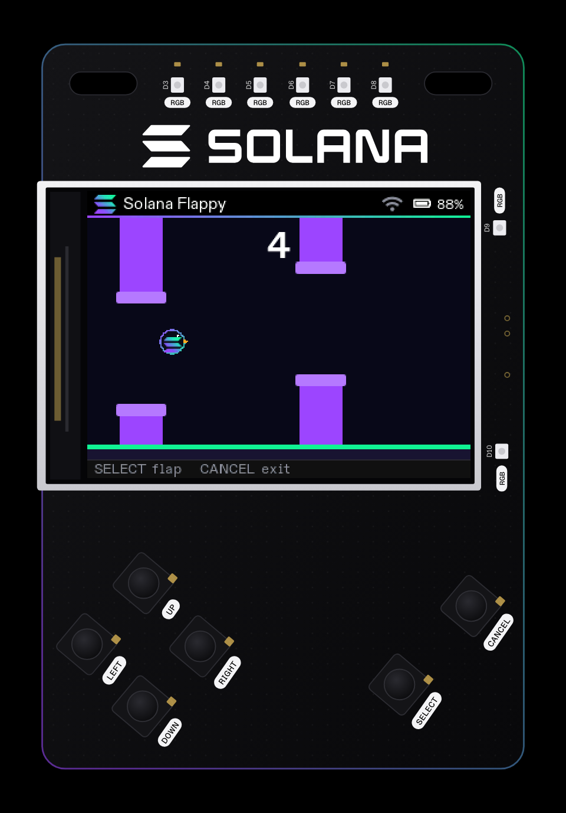
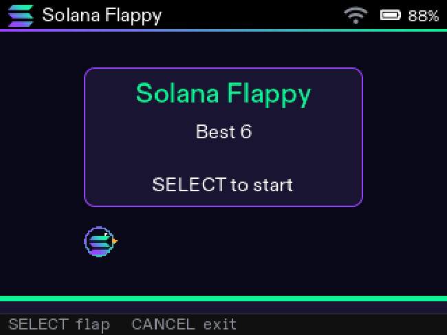
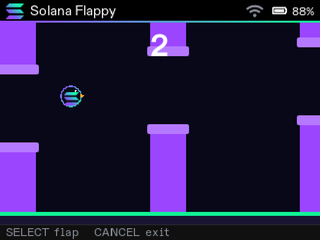
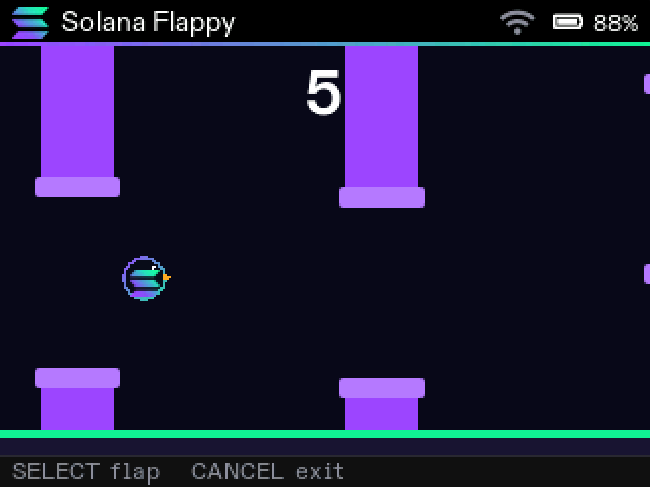
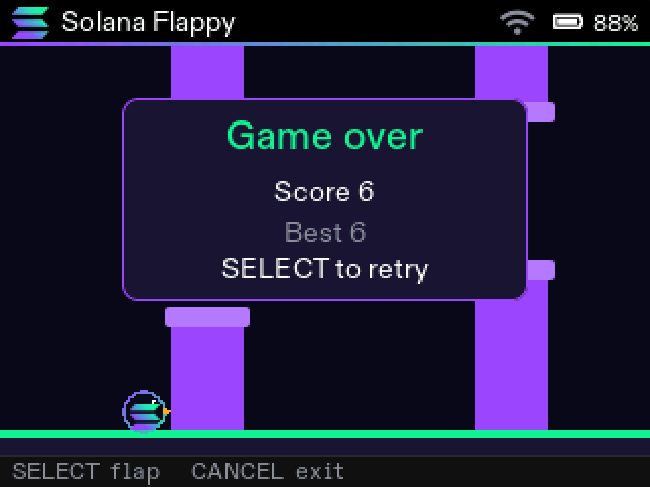
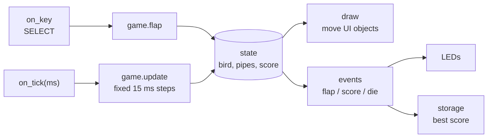

<div align="center">

# Solana Flappy

**Flappy Bird for the Solana BP26 badge, with the Solana coin as the bird.**

[](https://github.com/aluinn/solana-os-flappy-bird-/actions/workflows/ci.yml)
[](LICENSE)
[](https://github.com/aluinn/solana-os-flappy-bird-/stargazers)

<!--
  HERO PLACEHOLDER: replace the screenshot below with a short screen recording
  or GIF of real gameplay (e.g. docs/assets/demo.gif) once you have recorded one.
  Keep the original screenshot files; just point this  at the new file.
-->


[Architecture](docs/ARCHITECTURE.md) · [Roadmap](ROADMAP.md) · [Contributing](CONTRIBUTING.md)

</div>

## Features

- **One-button play.** SELECT flaps, starts and restarts; CANCEL returns to the launcher.
- **The Solana coin is the bird.** A 24×24 sprite built from the official logomark by [`tools/make_sprite.py`](tools/make_sprite.py), with a gold-disc fallback if the PNG can't load.
- **Frame-rate independent physics.** The simulation advances in fixed 15 ms steps, so gravity, flap and pipe speed feel the same at any tick length.
- **Endless pipes with random gaps**, recycled from a pool of three, so nothing is allocated while the game runs.
- **Circle-vs-rectangle collision** for the coin against pipes, ground and ceiling.
- **Best score is saved** to the app's private `storage` and shown on the title and game-over screens.
- **LED feedback** on the badge's 8 RGB LEDs: green on flap, purple on score, red on crash.
- **Testable game logic.** `solana-flappy/lib/game.lua` has no badge API in it, so it runs under plain Lua 5.5.
- **Small.** One permission (`led`), four files, and about 18 KB of Lua heap at launch measured in the emulator (the badge gives apps 6 MB).

## Screenshots

Captured from the hosted Solana OS emulator.

| Title | Playing |
|:---:|:---:|
|  |  |
| **Playing, later** | **Game over** |
|  |  |

<details>
<summary>How these were made</summary>

They come from [`tools/emu_drive.mjs`](tools/emu_drive.mjs), which installs the app in the emulator, presses keys and saves the screen. Staying alive long enough to score is hard to do at a screenshot's timing, so the in-game shots were played by a throwaway autopilot that lived only in a scratch copy of `main.lua` and is not in this repo. The game code, rendering and emulator are the real ones.

</details>

## How it works



1. **Input is tiny.** `on_key` only reacts to `"select"`; returning `false` for `"back"` lets Solana OS exit to the launcher.
2. **Time is fixed-step.** `on_tick(ms)` hands the elapsed time to `game.update`, which runs zero or more 15 ms simulation steps. A long stall is capped at 90 ms instead of replayed.
3. **Logic and drawing are separate.** `lib/game.lua` moves the bird and pipes, detects collisions and counts score. It sets one-shot event flags; `main.lua` reads them to flash LEDs and save the best score.
4. **Drawing moves objects, not pixels.** The badge's UI is retained objects, so each tick repositions a fixed set of rectangles and one image.

More in [docs/ARCHITECTURE.md](docs/ARCHITECTURE.md).

## Quick start

### Try it in the emulator

You need Node 22+ and Google Chrome. There is nothing to `npm install`.

```sh
git clone https://github.com/aluinn/solana-os-flappy-bird-.git
cd solana-os-flappy-bird-
HEADED=1 node tools/emu_drive.mjs
```

A Chrome window opens on the [hosted emulator](https://solana.com/breakpoint/badge/emulator) with the app installed and running. **Enter** is SELECT and **Esc** is CANCEL. The emulator's SD card lives in memory, so your best score is forgotten when the page reloads.

### Install on a badge (microSD)

1. Build the card layout: `tools/package_sd.sh` (writes `dist/sdcard/hh/apps/solana-flappy/`), or pass your mounted card, e.g. `tools/package_sd.sh /Volumes/MYCARD`.
2. If you used the default, copy the `hh` folder from `dist/sdcard/` onto the card. If a `hh` folder is already there, merge into it.
3. Put the card back in the badge, restart it, and open **Solana Flappy** from the launcher.

The badge needs Solana OS **0.5.0 or later**. The layout is documented in Solana OS's [Lua API reference](https://github.com/solana-foundation/solana-os/blob/main/docs/LUA_API.md) ("The package"). The docs also describe "Run on badge" over USB from the web editor if you'd rather not touch the card.

### Commands

| Command | What it does |
|---|---|
| `HEADED=1 node tools/emu_drive.mjs` | Open the emulator in a visible Chrome and play |
| `node tools/emu_drive.mjs script.json` | Run a scripted session and save screenshots (steps are listed in the file's header) |
| `tools/package_sd.sh [card path]` | Lay the app out for the microSD card |
| `python3 tools/make_sprite.py <img_logomark_40.c>` | Rebuild `solana-flappy/art/coin.png` from Solana OS's `main/assets/img_logomark_40.c` |

## FAQ

**Has it run on a real badge?** Not yet. It was built and played in the hosted emulator, which runs the badge's own firmware compiled to WebAssembly. The microSD steps above follow the Solana OS docs and source but haven't been tried on hardware.

**Why no sound?** Solana OS has no sound API. "audio" exists only as an app icon name.

**Why is the play area 320×218, not 320×240?** The panel is 320×240, but the app area below the status bar is 320×218 (`ui.W`, `ui.H`). The bottom 28 px here are the ground and the key-hint bar.

**Does it need Wi-Fi or an account?** No. The only permission is `led`.

**Is my best score kept?** Yes, with `storage` on the badge, until the app is removed. In the emulator it lasts until you reload the page.

**Is it fair on a slow tick?** Yes. Physics runs in fixed 15 ms steps, so a slower tick runs more steps per frame rather than changing how the game plays. A stall longer than 90 ms is clamped, so a hiccup won't teleport the bird into a pipe.

**Why is the bird hitbox a circle smaller than the sprite?** It's a 9 px radius on a 24 px sprite, which forgives the corners and the beak. Tune `BIRD_R` in [`lib/game.lua`](solana-flappy/lib/game.lua).

**Can I submit it to the App Store?** Probably, but I haven't. The store compiles Lua with the badge's own compiler, takes an account with X linked, and reviews the code.

**Is the Solana logo MIT-licensed?** No. See [Licence](#licence).

## Good first issues

Drafts live in [`docs/issues/`](docs/issues/). Copy one into a new GitHub issue.

| Issue | Label |
|---|---|
| [Brighten the "Best" line on the game-over card](docs/issues/01-brighten-best-score-line.md) | good first issue |
| [Change pipe colour as the score climbs](docs/issues/02-pipe-colour-by-score.md) | good first issue |
| [Sweep the 8 LEDs on score](docs/issues/03-led-score-sweep.md) | good first issue |
| [Add edge-case tests for the game logic](docs/issues/04-edge-case-tests.md) | good first issue |
| [Add alternative bird sprites](docs/issues/05-sprite-variants.md) | good first issue |
| [Difficulty levels](docs/issues/06-difficulty-levels.md) | enhancement |
| [Pause with a key](docs/issues/07-pause.md) | enhancement |
| [Two-badge race over the mesh](docs/issues/08-mesh-race-mode.md) | enhancement |
| [Parallax background](docs/issues/09-parallax-background.md) | enhancement |

## Roadmap

See [ROADMAP.md](ROADMAP.md).

## Credits

- **[Solana OS](https://github.com/solana-foundation/solana-os)** by the Solana Foundation: the badge firmware, the Lua app host and the [Lua API](https://github.com/solana-foundation/solana-os/blob/main/docs/LUA_API.md) this game is written against, plus the browser emulator used for testing and screenshots.
- **The Solana logomark** in the bird sprite is a Solana Foundation brand asset, decoded from Solana OS's `main/assets/img_logomark_40.c`.
- **[Lua 5.5](https://www.lua.org/)** (PUC-Rio, MIT) is the language Solana OS runs apps in; **[LVGL](https://lvgl.io/)** (MIT) is the UI library underneath its `ui` module.
- Pipe and ground colours use Solana's purple (`#9945FF`) and green (`#14F195`).

## Licence

The code in this repository is [MIT](LICENSE) © Aluinn McDonald.

That does **not** cover the Solana logomark. `solana-flappy/art/coin.png` contains it, and it stays subject to the Solana Foundation's brand terms, as it does in Solana OS itself. Don't reuse the sprite outside this app. Solana OS's own README says the same of the logos and fonts in its `main/assets/`.
