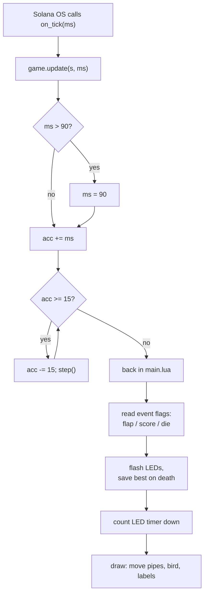
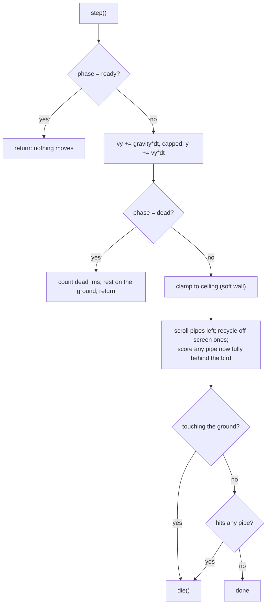
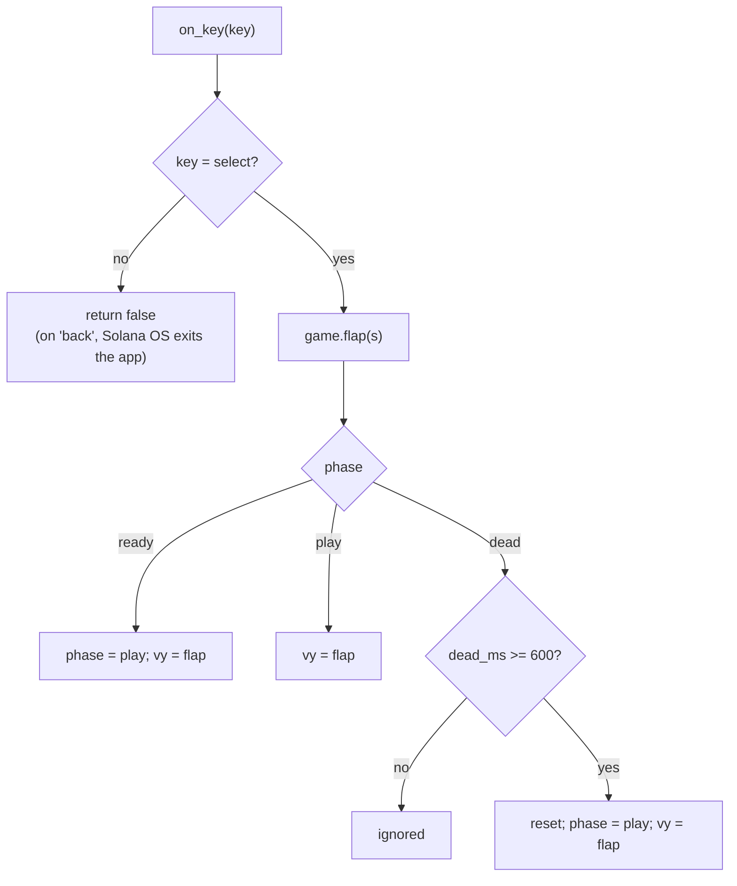
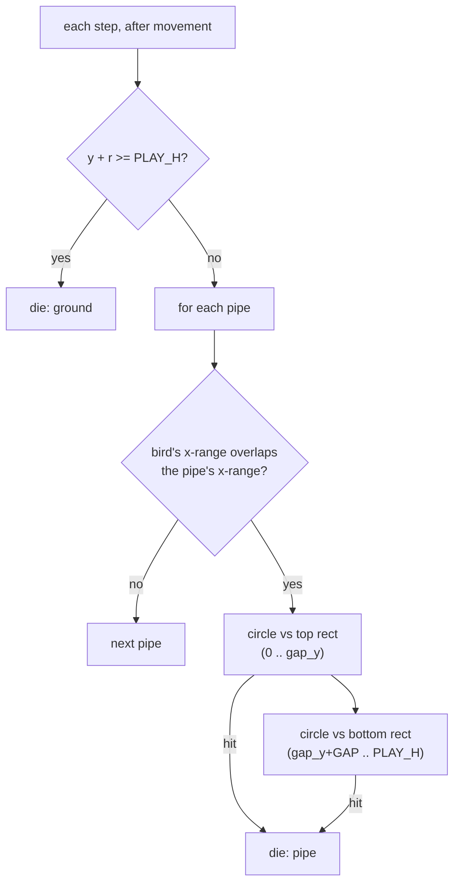

# Architecture

Solana Flappy is two Lua files with a hard line between them:

- **`solana-flappy/lib/game.lua`** is the rules: physics, pipes, collision, score. It touches no badge API, so it runs under plain Lua and is the part that gets tested.
- **`solana-flappy/main.lua`** is the badge side: it builds the UI, turns key presses into game calls, ticks the game, and moves UI objects to match. It also drives the LEDs and `storage`.

Solana OS calls three globals that `main.lua` defines: `on_key(key)`, `on_tick(ms)` and `on_exit()`. Everything else follows from them.

## Folder map

```text
solana-flappy/          the app, in the layout Solana OS expects
  app.json              manifest: id, name, icon, one permission ("led")
  main.lua              UI, input, LEDs, storage, the three callbacks
  lib/game.lua          pure game logic (no badge API)
  art/coin.png          24x24 bird sprite, generated
tools/
  make_sprite.py        builds art/coin.png from Solana OS's logomark array
  emu_drive.mjs         drives the hosted emulator: install, run, keys, screenshots
  package_sd.sh         lays the app out for a microSD card
  bench_logic.lua       desktop benchmark of lib/game.lua
  perf_emulator.json    emulator scenario that reads the firmware's own figures
docs/
  ARCHITECTURE.md       this file
  PERFORMANCE.md        measured numbers and how to reproduce them
  assets/               screenshots used by the README
  issues/               drafts for GitHub issues
```

## Game loop

Solana OS calls `on_tick(ms)` every 30 ms (50 ms on firmware before 2.1.0), passing the time since the last tick. The game does not count ticks; it turns elapsed time into fixed 15 ms simulation steps.



One `step()` does this, in order:



## Input handling

Only SELECT does anything. CANCEL is deliberately not handled, so Solana OS's default applies and the app exits.



A flap *sets* the velocity instead of adding to it, so mashing the button can't build up unlimited upward speed. `on_key` applies the flap straight away rather than queueing it for the next tick, so input latency doesn't depend on the tick length. On exit, `on_exit` saves the best score.

## Collision

The bird is a circle (centre `BIRD_X`, `y`; radius 9) against axis-aligned rectangles.



`circle_hits_rect` finds the point of the rectangle nearest the circle's centre (by clamping the centre to the rectangle) and compares the squared distance with the squared radius. There is no square root. The x-range check up front skips the two rectangle tests for the pipes that aren't near the bird, which is most of them at any moment.

## Decisions and trade-offs

**Rules and drawing are separate files.** The obvious thing is one `main.lua`. Splitting `lib/game.lua` out costs an indirection (draw code reads the game's state table) and one `require`. It buys tests that run with plain Lua, with no badge or emulator, and keeps game rules from depending on the UI.

**Fixed 15 ms steps, not "multiply by `ms`".** Scaling movement by the tick's `ms` is the usual shortcut and is what the API docs suggest. A fixed step instead makes the result identical whatever the tick length, which matters because the tick is 30 ms on current firmware and 50 ms on older. It also stops a long stall from tunnelling the bird through a pipe. The trade-offs are a small accumulator and that drawing shows the last completed step, not an interpolated position, so motion can lag by up to 15 ms. For a game with a 100 px/s scroll speed that is a pixel and a half.

**A long stall slows the game instead of being replayed.** Time is capped at 90 ms per tick. If the badge hangs for a second, the game continues from where it was rather than running 66 steps at once. The cost is that the game briefly runs slow after a hitch, which is the better failure for a one-button game.

**Events are flags, not callbacks.** `game.update` sets `ev_flap`, `ev_score` and `ev_die`, and `main.lua` reads and clears them. Callbacks would have been more flexible but would need closures, and flags keep the logic free of any dependency on `main.lua`. Stepping allocates nothing (see [PERFORMANCE.md](PERFORMANCE.md)).

**A pool of three pipes.** Pipes are recycled behind the last one instead of created and destroyed. On the badge, UI objects are capped at 128, live in SRAM and not in the Lua heap, and creating one can fail when SRAM is low. Reusing a fixed set removes that failure and the allocations. Three is enough: pipes are 150 px apart and 36 px wide, so at most three can touch the 320 px screen at once, and a recycled pipe is placed 150 px behind the farthest one, off-screen. In a 400,000-step simulation (with restarts) every one of 4,662 newly placed pipes started beyond the right edge (smallest x 378.5, screen width 320) and never more than three were on screen at once, so a pipe doesn't pop into view.

**Retained UI objects, not a canvas.** For a game the obvious route is `ui.canvas`, and the docs say redrawing a small canvas each tick is fine. But a canvas is a grid of pixels held in the Lua heap at 2 bytes each, and the docs charge one instruction per 16 pixels written. A full-screen 320×218 canvas would be about 140 KB, and redrawing it every tick about 4,400 instructions (my arithmetic from those two figures, not a measurement). A small canvas scaled up is cheaper, but then the art is blocky. Repositioning a dozen rectangles and one image keeps full-resolution edges and costs a few `pos` and `size` calls per pipe. The measured peak is 2,808 instructions in a callback (see [PERFORMANCE.md](PERFORMANCE.md)). The cost is that visuals are limited to what rectangles and an image can express: flat pipes and no rotating bird, since the documented image API has `scale` but no rotation.

**Coordinates are floored to integers.** `ui` methods use `luaL_checkinteger`, so a fractional float raises an error and stops the app. The simulation keeps floats for smooth motion, and `main.lua` floors them at the drawing boundary.

**LED timing is a countdown, not `timer.after`.** The docs' own example uses `timer.after(80, led.off)`. Here the LED "on" time is a number decremented in `on_tick`. Timers are limited to 8 at a time and each `after` creates a closure; a countdown has neither limit.

**The hitbox is smaller than the sprite.** The sprite is 24 px but the collision radius is 9, so the beak and the corners of the coin don't count. That is forgiving on purpose. The ceiling is a soft wall instead of a killer, as in the original game.

**The score ticks when a pipe clears the bird's trailing edge**, not its centre, so you only score once fully past.

**Saving the best score is rare on purpose.** `storage` writes to the microSD card. The best score is written when you die with a new best, and on exit, not on every point.

**Gold-disc fallback.** The sprite load is wrapped in `pcall` and falls back to a gold disc drawn as a fully rounded rectangle, so a missing PNG degrades the look but doesn't stop the game.

## Failure modes

| What goes wrong | What happens | Why / mitigation |
|---|---|---|
| `art/coin.png` is missing or unreadable | A gold disc is drawn instead | `pcall(ui.image, ...)` with a fallback |
| `storage` holds a non-number for `best` | Best score starts at 0 | Type-checked on load |
| The tick stalls (a hitch, or a 50 ms tick on old firmware) | The game runs briefly slow; it never jumps | Frame time clamped to 90 ms, fixed steps |
| The player mashes SELECT on the game-over card | Presses are ignored for 600 ms | Stops the result screen being skipped by accident |
| A non-integer is passed to `pos` or `size` | The app stops with an error | All drawing coordinates are floored in `main.lua` |
| The app is closed mid-run (HOME or CANCEL) | The best score is saved; the run itself is lost | `on_exit` saves; run state isn't persisted |
| Callback runs past 200,000 instructions | The firmware stops the app ("Script took too long") | Measured peak is 2,808, about 1.4% of the limit |
| Out of Lua heap (6 MB) | The firmware stops the app | Measured peak is about 36 KB |
| More than 128 UI objects | `ui.*` calls raise an error | The game makes 21, created once at launch |
| Score overflows 32 bits | Would wrap | Unreachable in practice: it would take about 2 billion pipes |
| The emulator page is reloaded | The best score is lost | The emulator's SD card is in memory; a real badge keeps it |
| Two consecutive gaps are too far apart to reach | Unavoidable death | Gap centres are random and independent, so some pairs are harder than others. The largest vertical jump is 58 px over 1.5 s. I haven't proved every sequence passable; the evidence is that a simple autopilot cleared 398 pipes in a row with one random seed |
| Pipes and score in the same step | The score can tick in the step where you die | Scoring runs before collision in `step()`. Harmless, but worth knowing |

## What is not covered

The game has been run only in the hosted emulator. Real-badge details (button latency, LED brightness, tick jitter) are unverified.
